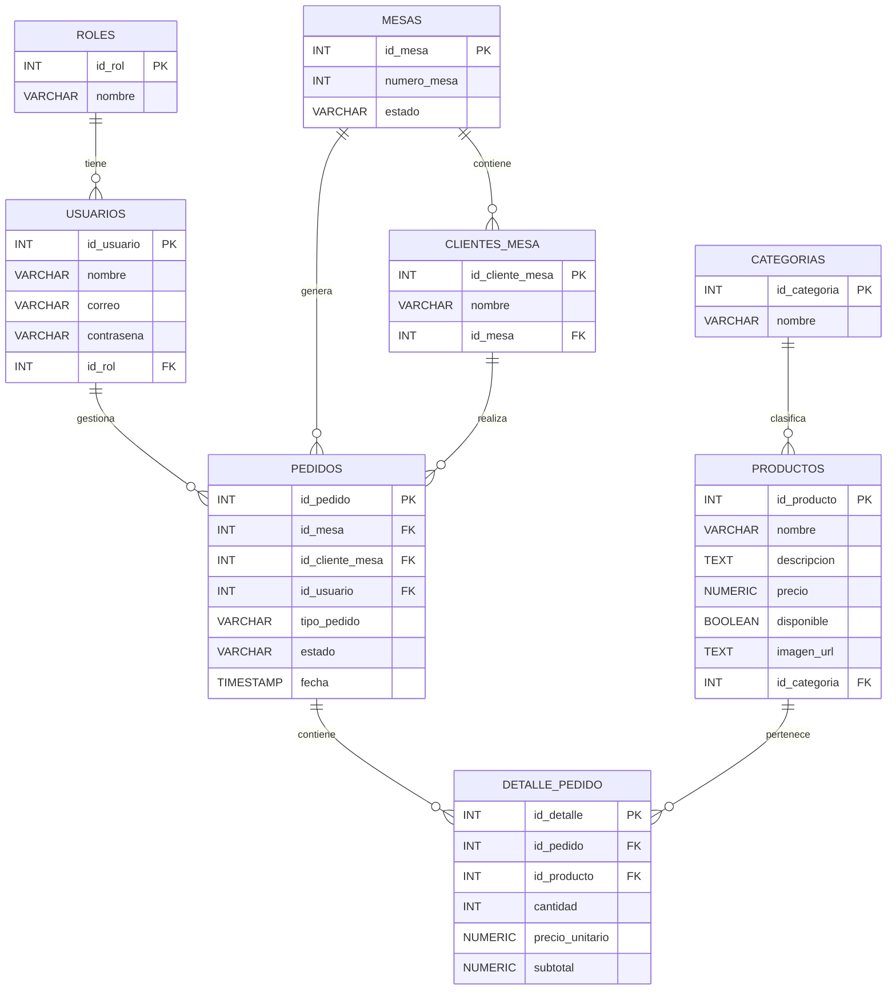

# Proyecto desarrollo de software

“Nuestro proyecto es una aplicación web que permite a los clientes de un restaurante hacer pedidos escaneando un código QR en la mesa. Esto agiliza el proceso, reduce errores y permite dividir cuentas fácilmente, mientras que el restaurante puede gestionar pedidos en tiempo real.”

## Base de datos del proyecto:

